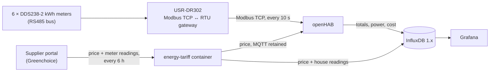

# Energy monitoring

How the house's electricity use is measured, priced and shown. Built 2026-11-14; it replaces the
old `energy-meters` container (a separate Python app that read the meters once an hour; retired,
its repo `ananchev/energymeter` archived on GitHub; the parts still useful now live in this folder).

## The short version

* **Six DIN-rail kWh meters** in the fuse box each measure one group of circuits.
* **openHAB** reads them every 10 seconds over Modbus, checks the readings, adds up the cost, and
  stores everything in **InfluxDB**.
* A small **`energy-tariff`** container fetches the current electricity price, and whatever house
  consumption data the supplier has, from the energy supplier's customer portal.
* **Grafana** (dashboard **Energy**) shows live power, plus kWh and € per circuit.



## Hardware

| Part | Notes |
|---|---|
| Meters | Single-phase DDS238-2 ZN/S, one per group. Each has its own Modbus id (see "Setting a meter's Modbus id"). Datasheet: `datasheets/DDS238-2-ZNS-energy-meter.pdf`. |
| Planned meter | A DDS661 (single-phase, RS485 Modbus) for the one circuit that is not metered yet; installed once the device arrives. Manual: `datasheets/DDS661-rs485-energy-meter.pdf`. Its register map can differ from the DDS238-2, so check the manual before adding it to `energyMeters.things`. |
| Bus | RS485, 9600 baud, 8N1. One bus carries all meters (and the garden soil sensor). |
| Gateway | USR-DR302: a TCP server on port 502 that converts Modbus TCP to RTU. Its web UI "TX count" stays 0 even when it works. It forwards every reply to **all** connected TCP clients, so only openHAB should talk to the bus. Manual: `datasheets/USR-DR302-rs485-to-ethernet-gw.pdf`. |

Meter registers used (holding registers, read in one block 0–21):

| Register | Value | Scaling |
|---|---|---|
| 0–1 | Lifetime energy, kWh | uint32 ÷ 100 |
| 12 | Voltage, V | ÷ 10 |
| 13 | Current, A | ÷ 100 |
| 14 | Active power, W | signed int16 |
| 15 | Reactive power, kvar | ÷ 1000 |
| 16 | Power factor | ÷ 1000 |
| 17 | Frequency, Hz | ÷ 100 |
| 21 | Modbus id (high byte) / baud code (low byte) | |

A slave that doesn't answer blocks the bus for its whole timeout (3 tries of about 3.4 s) on
every poll, which delays the meter reads. While the soil sensor (id 101) is broken, its thing is
**disabled** in openHAB (`openhab:things enable modbus:tcp:frontGardenHTmeter` turns it back on).

### Setting a meter's Modbus id

A new DDS238-2 usually comes with id 1 at 9600 baud. Two scripts in `meter-tools/` read and change register 21
(id in the high byte, baud code in the low byte: 1=9600, 2=4800, 3=2400, 4=1200). They are a
third-party script (Toulon7559, 2017) and talk to a **USB RS485 adapter** (`/dev/ttyUSB0`; on a Mac
something like `/dev/tty.usbserial-*`), not to the gateway. They need `pip install minimalmodbus`.

1. Wire the meter **on its own** to the USB adapter (A to A, B to B). Don't do this on the live bus:
   openHAB polls through the gateway and the two masters would collide. The broadcast read also
   only makes sense with a single meter connected.
2. `modbus-identify.py` reads id and baud through the broadcast address 0. Set `speed` in the
   script if 9600 shows nothing.
3. In `change-id.py`, set `present_address` / `present_rate` and `new_address` / `new_rate`, and run
   it once. Re-run `modbus-identify.py` to confirm.
4. Put the meter back on the bus, then add it in openHAB (see "Changing the wiring").

Ids in use: 2, 3, 4, 5, 10, 11 (meters) and 101 (soil sensor).

## Meters and circuits

A **meter** is a physical device; a **circuit** is what it measures. They are linked in exactly
one place: the item metadata in openHAB (see "Data in InfluxDB"). If wiring changes, only that
mapping changes, and the history stays correct (see "Changing the wiring").

| Modbus id | Circuit tag | What it measures |
|---|---|---|
| 10 | `kitchen_hob` | Induction hob (group 1). Verified with a load test. |
| 11 | `kitchen_2` | Second kitchen group. Very low use; probably the hob's second group. Not verified yet. |
| 2 | `ground_floor` | Ground-floor and shed outlets, WC |
| 3 | `oven_master_bed` | Oven + master bedroom & bathroom. The oven was verified with a load test. |
| 4 | `laundry` | Washing machine & dryer |
| 5 | `upstairs` | Corridor, small bedroom, attic |

The dakkapel group has **no meter**. See "What is not measured".

> The old app and dashboards called meters 10 and 11 "line0" and "line1", and meters 2–5
> "line2–line5".

## How consumption is calculated

Each meter has a **lifetime counter** (kWh since it was installed). The energy used in any period
is *counter at end − counter at start*. Where the counter started doesn't matter, and a missed
reading (openHAB restart, network outage) only delays the number: the next reading still
contains it.

openHAB doesn't store the raw counter directly. The rule `energy.rules` copies the raw reading
(`EnergyMeterNN_Raw`) into the stored `EnergyMeterNN_Total` only when the step is plausible:

* A reading **below** the stored total, or more than 50 kWh above it, is ignored. Without this, a
  single bad read (for example 0) would turn into a fake jump of thousands of kWh in Grafana.
* If 30 readings in a row (about 5 minutes) are implausible, the meter was really reset or
  replaced, and the new value becomes the baseline.
* The stored totals are restored after an openHAB restart, so energy used while openHAB was down
  is counted with the first new reading.

Grafana works out the difference **per series** (one series per item) and then adds the series
per circuit, in local time:

```sql
SELECT sum("d") FROM (
  SELECT non_negative_difference(last("value")) AS "d" FROM "energy_total_kwh"
  WHERE $timeFilter GROUP BY time(1d), "item", "circuit" tz('Europe/Amsterdam')
) WHERE $timeFilter GROUP BY time(1d), "circuit" fill(none) tz('Europe/Amsterdam')
```

Working per series keeps different meters, or the same meter before and after a remap, from being
mixed into one counter.

## How cost is calculated

The contract is a **variable single-rate** contract: one price per kWh, which the supplier can
change. To keep old periods at their old price, cost is added up **when the energy is used**,
not when the dashboard is viewed:

1. `energy-tariff` publishes the current all-in price (incl. energy tax and VAT) to MQTT.
2. openHAB keeps it in the item `ElectricityTariff`, which is restored after a restart.
3. Whenever a meter's total goes up, the same rule adds *increase in kWh × current price* to that
   meter's cost counter (`EnergyMeterNN_Cost`).
4. Grafana treats the cost counters exactly like the kWh counters.

Fixed costs (standing charge, grid fee, energy-tax rebate) are per day, not per kWh, and are not
included. Feed-in is not relevant (no solar).

**Manual override:** set `ElectricityTariff` in the openHAB UI. The next price fetch (within 6 h)
overwrites it.

## The supplier connection (`energy-tariff` container)

The supplier has no official API. The container logs in to the customer portal with the account's
email and password (stored in the Ansible vault) the same way a browser does. The login code is
taken unchanged from the MIT-licensed
[homeassistant-greenchoice](https://github.com/barisdemirdelen/homeassistant-greenchoice)
integration (`_templates/energy-tariff/app/greenchoice_auth.py`, licence file next to it).

Every 6 hours it fetches:

| What | Where it goes |
|---|---|
| Today's price (single rate, all-in incl. VAT) | MQTT `energy/tariff/electricity` + `energy/tariff/updated` (retained), and InfluxDB `energy_tariff_eur_kwh` |
| Hourly house consumption, kWh and €, for the last 3 days (if the supplier has it) | InfluxDB `house_energy` |
| The supplier's meter readings (register values) | InfluxDB `house_meter_kwh` |

If hourly data ever appears, a one-time import of the hourly history back to 2023-12 starts by
itself.

**When it breaks** (for example, the portal login changes):

* openHAB keeps using the last price: the MQTT message is retained, and the item is restored
  after a restart.
* If the price hasn't been refreshed for 48 h, a Telegram alert is sent (at most once a day).
* The meters and cost keep working. `docker logs energy-tariff` shows the reason.

## What is not measured

**The dakkapel group, and anything else without a meter.** The plan was to get it as *house
total − sum of the meters*. That needs the house consumption at a fine time resolution. For this
connection, the supplier has no hourly or daily data, only meter readings. Most are month-end
values the supplier **estimated**; only the odd-dated ones are real readings. Compared with the
meters, the estimates are off by up to 100 kWh a month, so they can't be used for a remainder.

Ways to get a real house total, best first:

1. **A P1 reader on the smart meter's P1 port** (a small dongle or a USB cable to pi5). It gives
   live whole-house power every second, and the remainder becomes a live value too.
2. **Allow remote smart-meter reading for the supplier** (if the meter supports it). Hourly data
   then shows up in `house_energy` automatically, and the backfill starts by itself.
3. **Give the dakkapel group a meter** (move or add one). Check first with an electrician that
   any groups sharing a single-phase meter are on the same phase and within its rated current.

## Data in InfluxDB

Everything is in the `openhab` database. All values are in the field `value` unless stated otherwise.

| Measurement | Written by | Tags | Value |
|---|---|---|---|
| `energy_total_kwh` | openHAB, on change and every 5 min | `item`, `meter`, `circuit` | lifetime kWh (validated) |
| `energy_power_w` | openHAB, every minute | `item`, `meter`, `circuit` | active power, W |
| `energy_cost_total_eur` | openHAB, on change and every 5 min | `item`, `meter`, `circuit` | lifetime € (counter) |
| `energy_tariff_eur_kwh` | energy-tariff | `source` | € per kWh, all-in |
| `house_meter_kwh` | energy-tariff | `source` | fields `normal`, `off_peak`, `total` (supplier register values) |
| `house_energy` | energy-tariff | `source` | fields `kwh`, `cost_eur`, `total_cost_eur` per hour (only if available) |

The meter-to-circuit link is the openHAB item metadata, for example:

```java
Number EnergyMeter10_Total "Hob total [%.2f kWh]" (gEnergyTotal)
       { influxdb="energy_total_kwh" [meter="10", circuit="kitchen_hob"] }
```

**History:**

* The old app wrote `line0Total` … `line5Total` (2023-12 to 2024-12-07). That history was copied
  into `energy_total_kwh` and `energy_cost_total_eur` under its own `item` tag
  (`EnergyMeterNN_Total_hist`, `…_Cost_hist`). Its cost uses one flat price, because the old prices
  weren't recorded.
* The live data starts on 2026-11-14. Because history and live data are separate series, the
  roughly 2 years in between, when nothing was recorded, are **not** counted. The real
  consumption in that gap is unknown per period.
* The old pre-summed measurements (`line*LastHour/LastDay/LastMonth/LastManual`) are deleted.
  The raw `line*Total` series are still there as the source of the copy, and can be dropped.

## Grafana

The **Energy** dashboard (uid `energy`) is stored in Grafana's own database and covered by its
nightly backup. `energy-dashboard.json` next to this file is a reference copy, not provisioned.
Rows:

* **Now:** total power, price, kWh and € for today and this month, power per circuit, and a
  stacked 24-hour power chart.
* **Consumption:** kWh and € per circuit for the selected time range, per *Bucket* (1h / 1d / 7d).
* **Insights:** each circuit's share, standby load per circuit (the lowest hourly average of the
  last 7 days), the same month last year, and the last 12 months.
* **House:** the supplier's meter readings (for reference only, see above).

Circuit names come from the `circuit` tag. The panels map the tags to readable names and fixed
colours (field overrides). A new circuit tag shows up automatically, but under its raw name.

openHAB's `conf/html/energy.html` embeds the 24-hour power panel.

## Changing the wiring

* **Move a meter to another circuit:** change the `circuit` value in that meter's three item
  metadata entries (`_Total`, `_Power`, `_Cost`). Old data keeps the old circuit name, and new
  data starts a new series. There's no spike, because differences are taken per series. Add a
  display-name override in Grafana for a new tag.
* **Add a meter:** give it a free Modbus id, then copy an existing meter's bridge in
  `energyMeters.things` and its items in `energyMeters.items`.
* **Replace a meter:** handled by the rule. After about 5 minutes of readings below the stored
  total, the new counter becomes the baseline.

## Files

| Where | What |
|---|---|
| openHAB `conf/things/energyMeters.things` | Modbus bridges (one per meter) and the MQTT tariff thing |
| openHAB `conf/items/energyMeters.items` | Items, groups `gEnergyRaw/Total/Power/Cost`, the influxdb metadata |
| openHAB `conf/rules/energy.rules` | Plausibility check, cost counter, baseline catch-up |
| openHAB `conf/persistence/*.persist` | InfluxDB strategies; mapdb restore of totals, cost and price |
| openHAB `conf/sitemaps/energy.sitemap` | Basic UI page per meter |
| `applications/energy-tariff.yml` | Deploys the supplier container |
| `_templates/energy-tariff/` | Its source, Dockerfile and secrets template |

In this folder:

| File | What |
|---|---|
| `openhab/` | Reference copies of `energyMeters.things`, `energyMeters.items`, `energy.rules` (taken 2026-11-14) |
| `energy-dashboard.json` | Reference export of the Grafana dashboard |
| `meter-tools/` | `modbus-identify.py`, `change-id.py` (see "Setting a meter's Modbus id") |
| `datasheets/` | DDS238-2 and DDS661 meter and USR-DR302 gateway manuals |

The reference copies are not deployed. The live files on pi5 are the source of truth: after changing
them, copy them here again. The openHAB files are part of openHAB's `conf/` and covered by its
backup (see `../openhab.md`).
`energy-tariff` has no backup definition: its only state (`data/state.json`: last price, import
progress) is rebuilt on its own. Its secrets file (`secrets/energy-tariff.json`, mode 0600) is
written by the playbook from the vault. It is mounted as a file, not passed as environment
variables, so the secrets don't show up in `docker inspect`.
